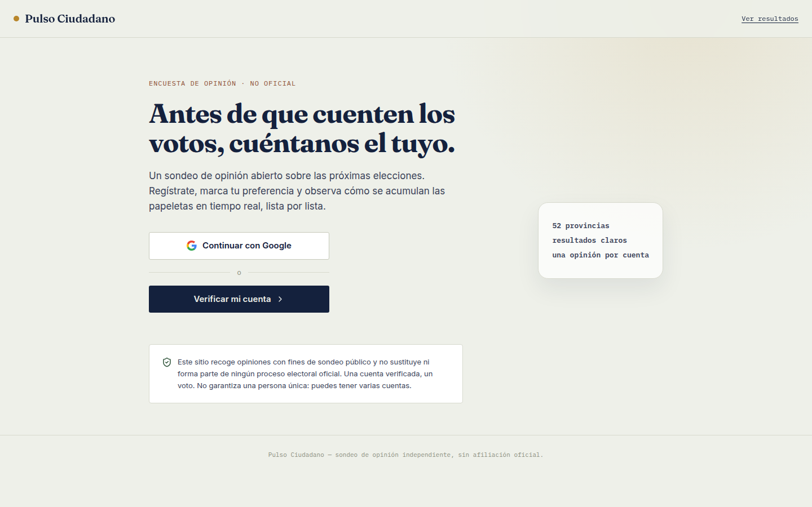
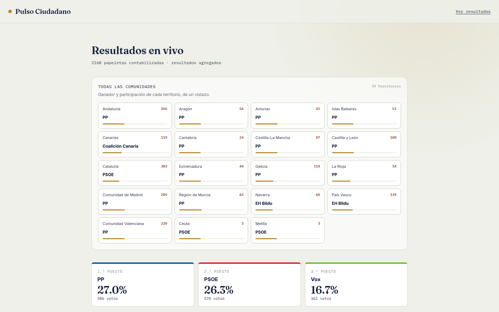
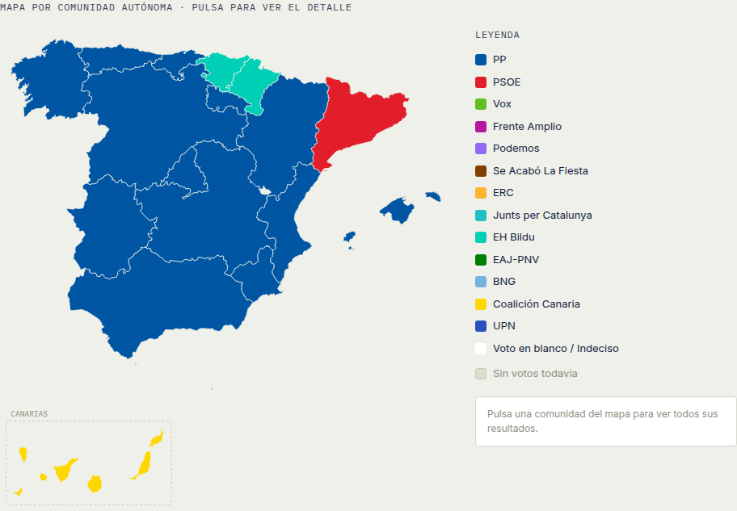

# Pulso Ciudadano

*Sondeo de opinión en vivo: una cuenta verificada, un voto, solo recuentos agregados.*  
*Sondeig d'opinió en directe: un compte verificat, un vot, només recomptes agregats.*

**A live opinion poll for Spain: sign in with Google, cast one ballot, and watch the public tally move by party, autonomous community, and province.**

It is an independent survey. It is not an official election and not a certified voting system.

Frontend project by Joel Novio Garcia.

## The problem

Most published polls are a static screenshot. You cannot see how a preference is counted, or how it differs between Barcelona and Badajoz, without trusting a PDF.

Pulso Ciudadano lets someone register a preference and shows everyone else only the running totals: a podium, a ranked bar list, a community grid, and a map of Spain. Names, emails, and individual ballots stay off the public page.

## Live demo

[https://pulso-ciudadano-green.vercel.app/](https://pulso-ciudadano-green.vercel.app/)

Open **Ver resultados** to see the aggregate tally without signing in. Casting or changing a ballot requires Google sign-in.

## Screenshots

Landing page in this version of the UI. The aside reads “52 provincias / resultados claros / una opinión por cuenta”.



Live results on the public demo: one card per autonomous community, then the top three lists. Figures are aggregate counts only.



The same demo, scrolled to the map. Color is the leading list in that community. Canarias sits in its own inset.



## Features

- Google sign-in before a ballot can be cast or changed.
- One ballot per verified account. The same account can update it later.
- Community and province pickers. The ballot only lists candidacies that stand in that community.
- Public results are grouped counts: community cards, a top-three podium, a share bar, and a ranked list.
- Clickable SVG map of Spain, including the Canary Islands, with a per-community breakdown.
- Participation totals by autonomous community and by province.
- Party names, colors, and where a list stands are edited in Supabase, not hardcoded for the live poll.
- Optional email when a ballot is saved. The Resend API key lives in Supabase Vault, not in this repo.

## Tech stack

- React 18 and Vite
- Tailwind CSS, plus a small set of layout classes for the results grid and the map
- [lucide-react](https://lucide.dev) for icons
- Supabase: Postgres, Google Auth, Row Level Security, and SQL functions
- Hosted on Vercel

The bars and the map are custom markup in the page.

## Architecture

The browser is a single React app. It talks to Supabase and never to a custom server.

```text
React (Vite)
  ├─ Google sign-in          supabase.auth
  ├─ read candidacies        public.candidates
  ├─ my ballot / cast ballot my_vote(), cast_vote()     authenticated
  └─ public tally            vote_results_by_province() anon + authenticated
                                      │
                                      ▼
                               Postgres (RLS)
                               votes: no direct client read or write
                               optional trigger → Resend, key read from Vault
```

- `candidates` can be read by the client. `votes` cannot. The app does not query vote rows.
- `cast_vote` and `my_vote` require a verified session. Ownership comes from `auth.uid()`. The email stored on the ballot is the confirmed account email, not a value typed into the form.
- `vote_results` and `vote_results_by_province` return grouped counts (`region` or `province`, candidacy, `vote_count`). They do not return names, emails, or row ids.
- A verified account is one ballot. It does not prove that each account is a different person.
- Older rows with no `user_id` are kept. They are not claimed automatically from an email address.

Apply the SQL to your own project in this order, after a backup: [`001_supabase-setup.sql`](./supabase/migrations/001_supabase-setup.sql), then [`002_provincias.sql`](./supabase/migrations/002_provincias.sql), then [`003_security-hardening.sql`](./supabase/migrations/003_security-hardening.sql). Deploy this frontend after that SQL. Details, Google OAuth, and the Vault step are in [`SETUP.md`](./SETUP.md).

## Run locally

Node.js 18 or newer.

```bash
npm install
cp .env.example .env
```

Edit `.env` and set the two public client values from Supabase → Project Settings → API:

```bash
VITE_SUPABASE_URL=https://YOUR-PROJECT.supabase.co
VITE_SUPABASE_ANON_KEY=your-anon-public-key
```

```bash
npm run dev
```

Vite serves the app at [http://localhost:5173](http://localhost:5173).

`.env.example` is the only env file that belongs in git. Do not commit `.env`, `.env.local`, or a service-role key. Do not put a Resend API key in the frontend. Create it in the Supabase SQL editor with `vault.create_secret(...)`, as described in [`SETUP.md`](./SETUP.md). Files named `*.secret.sql` are gitignored for that reason.

Checks that ship with the repo:

```bash
node --test tests/*.test.cjs tests/*.test.mjs
```

## License

MIT. Use it, change it, and deploy your own poll.
